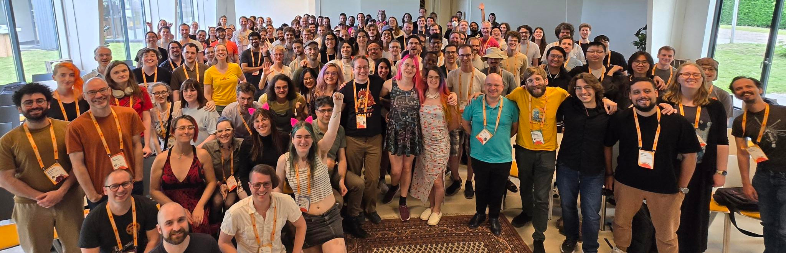

+++
path = "inside-rust/2026/11/23/all-hands-2027"
title = "Rust All Hands 2027"
authors = ["Mara Bos"]

[extra]
team = "the all hands team"
team_url = "https://rust-lang.org/governance/teams/launching-pad/#team-all-hands"
+++

The Rust All Hands 2027 will again take place in **Utrecht, the Netherlands** as part of [RustWeek 2027], hosted by [RustNL].
The RustWeek conference takes place on Tuesday (25 May) and Wednesday (26 May) followed by the three-day Rust All Hands
on **Thursday (27 May), Friday (28 May) and Saturday (29 May)**!

The second conference day (Wednesday 26 May) will again include a "Rust Project Track", where Rust team members can give talks to other team members and current and future contributors.

The Rust All Hands is a private event for people affiliated with the Rust project. This could
be Rust team membership, participation in a working group, owning a project
goal, or similar involvement in the future of the Rust project.
If you want to join the Rust All Hands 2027, please [register here][form].

<strong>→ <a href="https://forms.gle/Js6UDdrb7S2tpH5P9">Register here</a> ←</strong>

If you have any questions, please reach out to Mara on Zulip.

See you in Utrecht!

[form]: https://forms.gle/Js6UDdrb7S2tpH5P9
[RustWeek 2027]: https://2027.rustweek.org/
[RustNL]: https://rustnl.org/about/
