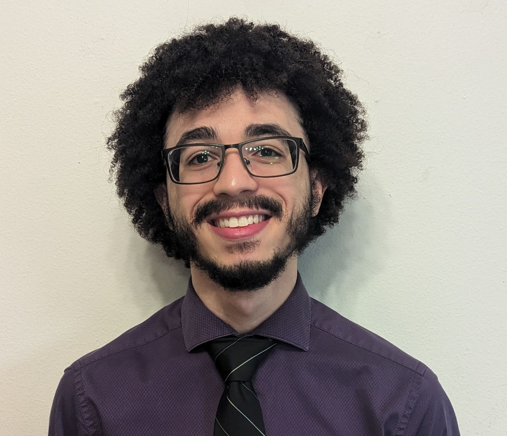

+++
path = "inside-rust/2026/11/02/maintainer-spotlight-anthony-bolden-walnut356"
title = "Maintainer spotlight: Anthony Bolden (@Walnut356)"
authors = ["Jakub Beránek"]

[taxonomies]
tags = ["maintainer-spotlight"]

[extra]
team = "the Content team"
team_url = "https://www.rust-lang.org/governance/teams/launching-pad#team-content"
+++

There are [hundreds][all-members-page] of people who [maintain][maintenance-post] the Rust toolchain, often on a volunteer basis on top of another job. The Rust [Content team][content-team] is working on a series of blog posts highlighting some of these prolific contributors to recognize the awesome work that they are doing in order to make Rust better for everyone. You can find the previous post [here][previous-post].
**Consider [donating][rfmf] to the Rust Foundation Maintainers Fund if you'd like to support Rust Project maintainers.**

<aside style="float: right; clear: both; margin-left: 10px;">
  
</aside>

In this post, we would like to introduce **Anthony Bolden** ([@Walnut356](https://github.com/Walnut356)). Anthony is a self-taught programmer who went on a mission to improve the Rust debugger experience. This year, he participated as a contributor in the Google Summer of Code program, and recently he joined the Rust compiler team. 

We interviewed Anthony to find out what brought him to programming and how he became an expert on debuggers. Read more below!

**Can you briefly introduce yourself and tell us how you started with programming?**

Hello, my name is Anthony Bolden, also known as `@Walnut356`, and I live in Wisconsin. I do not have any formal computer science education and I've never had a job in the tech industry, so my journey to programming was a bit different. I work overnight shifts in a hotel, where I often have a lot of time to spare, and I needed something to occupy my mind. For I while, I used to solve puzzles or read books, but eventually I got tired of that.

I wanted to find a long-term project, so I tried programming. It took me a couple of tries until it "clicked", but when that happened, I instantly fell in love with it. It is so much fun!

**How did you discover Rust?**

I bought a couple of C++ books when I was learning how to program, so that was my entrypoint. But I was very dissatisfied with the development experience there. I wanted to make a simple game, because I've always found game design fascinating, but adding a dependency like SDL to my project turned out to be very difficult. I spent SO MUCH time trying to get it to work, and it didn't help that I was doing it on Windows. It should not be that hard!

I really enjoy low-level programming, optimization work, reading assembly for fun… but C++ was not for me. So I switched to Python, even though I was not super satisfied with its performance and its typical use-cases. At the time, I played Super Smash Bros. Melee competitively, and I wanted to analyze replays from my matches to improve my play. There was an existing Python replay parser, but it was outdated and slow. I forked it, and through painstaking effort I managed to double its performance. But when working with thousands of replays and gigabytes of data, it still took an hour to process everything in Python.

Then I realized that the original author of the Python parser abandoned it because they ran into the same performance problems. They decided to rewrite it in Rust instead. I took a look at the Rust code, but it seemed *really* complicated. It took me a few tries to break through the syntax barrier, but it didn't take long to realize that Rust is exactly where I wanted to be. It gave me the power to express exactly what I wanted, it was incredibly fast, and I didn't have to constantly fight just to add a dependency or build my project.

**You are doing a lot of work in the area of debuggers. What started that interest?**

When I started with Rust, I solved a lot of Advent of Code tasks, and I was debugging *constantly*, because it was my first exposure to data structures and algorithms.

One day, CodeLLDB, which is a Visual Studio Code debugger plugin that I was using, removed their built-in Rust support, instead falling back to the visualizer scripts Rust distributes in its toolchains. That instantly made my debugging experience terrible, because those scripts weren't part of MSVC toolchains, and there were no alternatives at the time that would enable debugging with LLDB on Windows.

Luckily, we programmers have a superpower: we can fix our own tools. At first, I wanted to contribute to either CodeLLDB, LLDB or LLVM itself to improve things. I've always been very interested in developer tooling anyway, so this was the perfect excuse to get started.  However, trying to work with the LLVM codebase on Windows was just abysmal. I could not get my editor's C++ language plugin to work on its codebase, so I might have as well have been writing code in Notepad. After several weeks of frustration, I started looking into other options.

The CodeLLDB maintainer suggested that it might be possible to fix the debugger visualizers on the Rust side. I was very pleased with the Rust tooling experience so far, but I was worried that building the Rust compiler would be an absolute nightmare, just like with LLVM. I cloned the Rust repo, ran the build command, and it just *worked*. On the first try, without any errors. I immediately thought "I need to put all of my focus on this". It was absolutely beautiful, there was no "environment hell" to work through before I could start writing code.

**Dealing with debugger internals sounds complicated. How did you learn it?**

I read through the CodeLLDB debuginfo visualizers, and it spiraled from there. When I find something I don't understand, I immediately open a new browser tab and look into it. That often leads to something else I don't understand, until I suddenly realize that I have 70 browser tabs open. There is an unbelievable amount of complexity in all this.

**How did you start contributing to Rust?**

Back in 2024, the Rust toolchain did not distribute debuginfo visualizers on Windows. Fixing that was one of my [first contributions][first-pr]. Back then, the Rust compiler debuginfo test suite did not work on Windows at all, so I had to provide "proof" that my pull requests worked via screenshots.

Sometimes, I work on debuginfo improvements out of spite, because I'm a bit mad about the state of debugging in Rust when working on my own projects. But in general, I want to improve it also for everyone else, because many people are [dissatisfied][debuginfo-survey] with it. It feels nice and rewarding to be able to take something (like the LLDB debugging experience on Windows) from not working at all to working reasonably well.

Due to my background, I don't have a college thesis or some sort of big project that I could be proud of, so having something that I can collaborate on with a large amount of people and be able to genuinely help out feels super good. The Rust Project is actually one of the nicest communities that I ever interacted with, everybody has been super kind and helpful.

**This year, you participated in Google Summer of Code. How did you find it?**

I heard about Google Summer of Code in 2025, but at the time, I didn't feel confident enough in my skills to participate. Looking back, I maybe could have done it, but I didn't have a project in mind anyway. Eventually, I realized that I would probably never feel confident enough in my coding skills. I had to just try it. This year, after discussing the testing situation with the compiler team, I applied for a project to improve the state of Rust compiler debuginfo tests.

When I was in high school, I had some difficulty with long-term, self-structured projects, so I was a bit worried about how it would go. But in the end, I think it went better than I would have expected. I stayed motivated, consistently worked on my project, and I think that I made really good progress on the goals that we set out.

I think I improved in a lot of programming-adjacent skills too. It used to be very difficult for me to keep up with having multiple pull requests open at once, constantly switching between different git branches while staying organized. I feel like I got much better at that.

I also became more confident in the whole contribution process. Opening a single pull request actually used to be a very big deal to me! I talked to my girlfriend about it, kept her updated whenever I got a review or it got merged, it was a whole thing. Nowadays, I open 2 or 3 pull requests at once, and it's not a big deal anymore.

**After finishing your GSoC project, you were invited to the Rust Compiler team. What does that mean to you?**

I got blindsighted by it! I was going to ask about the process for joining the compiler team that I would have to go through, but before I even asked, I was invited to the team. I'm still kind of in shock, to be honest. When I accepted it, I looked at the list of compiler team members, whose blog posts I have been reading for years. I don't have the sort of background, or a PhD, or a prestigious job at a giant tech company that many of them have. I look up to them and respect them so much, and it is such an honor to be working alongside them and learning from them.

It will sound silly, but when I [appeared][walnut-rust-website] on the Rust website after becoming a member of the team, it brought me to tears. I worked really hard the past couple of years, and it's easy to think "my code isn't good enough" or "what I'm doing isn't important". It is very cool that I was able to follow through with something that I set out to do, and I was recognized by other people for it. Since being added to the compiler team, I actually found out that my background is not that unique, and that there are others in the compiler team that are self-taught! It's really reassuring.

Participating in GSoC and joining the compiler team also made it easier to explain to others what it is that I do. Trying to explain how open source works to my grandparents was difficult, because it almost sounds like a scam. It helps a lot when I can show them on the Rust website that I am now a part of the team that maintains the compiler. It is something tangible that they can brag to their friends about.

**What are you working on right now?**

Now that the debuginfo testing situation is no longer so dire, it freed me up to start adding new features to the debugger visualizers. I want to improve the visualizers for the `Vec` type and for wide pointers, allow indexing hashmaps in the debugger, and much more. There is also a large number of performance wins that we could achieve.

Recently, I learned that LLDB maintainers plan to improve their plugin interface, which might allow us to have a native Rust debugging integration. That would allow implementing much better expression parsing and maybe integrating the debugger with miri. Another idea is that we could ship debuginfo visualizers written in Rust.

**Would you like to work on Rust professionally?**

If I could work on improving Rust debuginfo full-time, that would actually be the dream for me. I have a lot of fun with this, and I do it both during my night shifts, and in my free time. I would love to have a programming job in general, though I guess I sort of chose the wrong time to get into the industry, with the state of the job market right now.

**What advice would you give someone just starting their Rust journey?**

When you are starting to learn Rust, don't worry about best practices too much. Experiment, push boundaries, try everything, even if your code looks a bit gross. If the compiler tells you no, and you think it should work anyway, then argue with it! Try different things, do your research, and find out why it works the way that it does. If you just blindly follow best practices from the start, you might end up with a tunnel vision and not learn some important lessons.

We thank Anthony for sharing his thoughts with us, and for all his work on improving the Rust debugging experience! You can read more about his debuginfo adventures on his [blog][walnut-blog].

[all-members-page]: https://rust-lang.org/governance/people
[content-team]: https://rust-lang.org/governance/teams/launching-pad/#team-content
[rfmf]: https://github.com/sponsors/rustfoundation
[maintenance-post]: https://blog.rust-lang.org/inside-rust/2026/01/12/what-is-maintenance-anyway/
[previous-post]: https://blog.rust-lang.org/inside-rust/2026/09/21/maintainer-spotlight-alejandra-gonzalez-blyxyas/
[first-pr]: https://github.com/rust-lang/rust/pull/133737/
[debuginfo-survey]: https://blog.rust-lang.org/2026/09/07/rust-debugging-survey-2026-results/
[walnut-rust-website]: https://rust-lang.org/governance/people/Walnut356
[walnut-blog]: https://walnut356.github.io/
